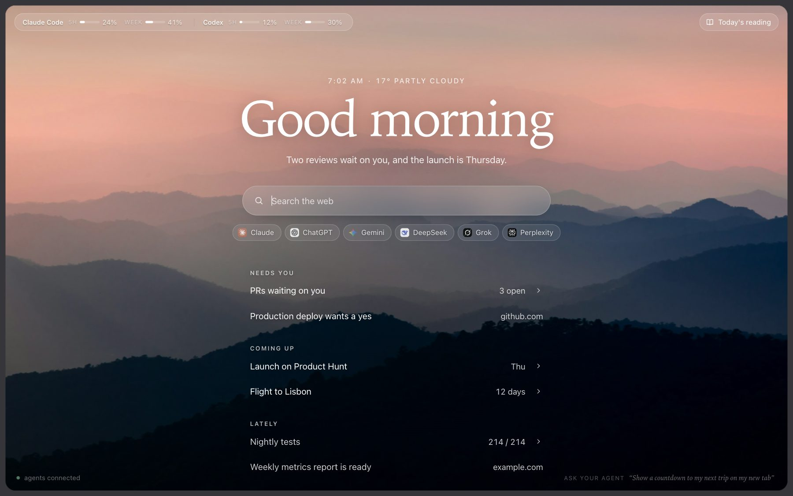
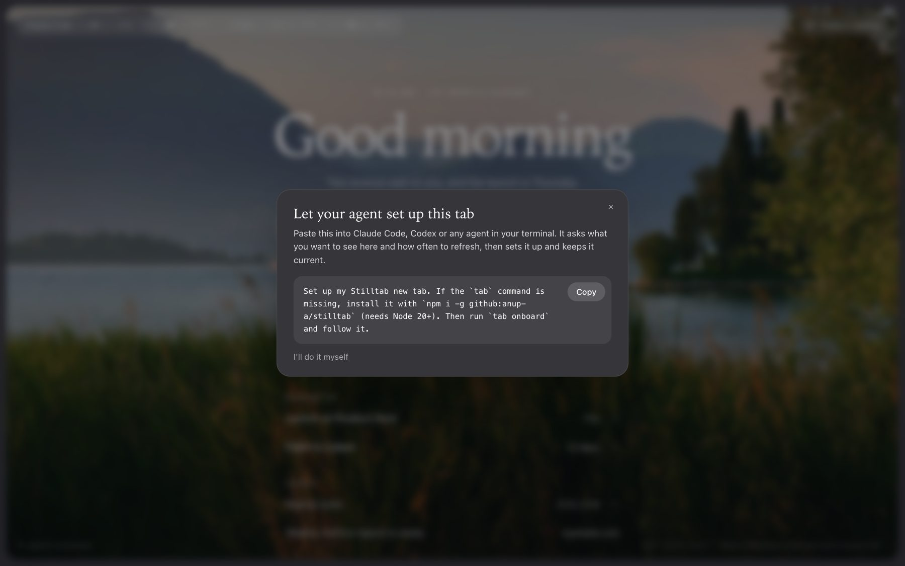
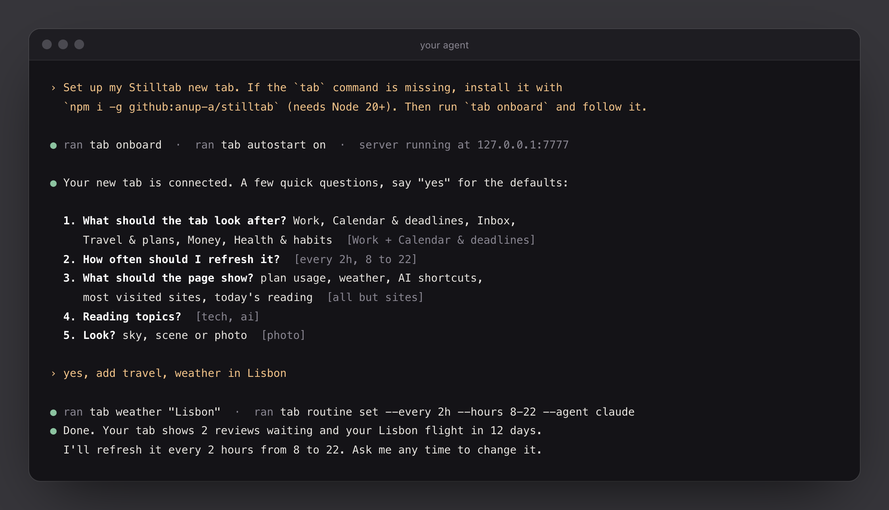
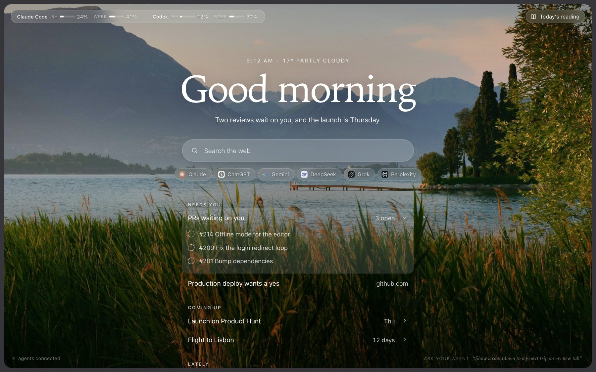
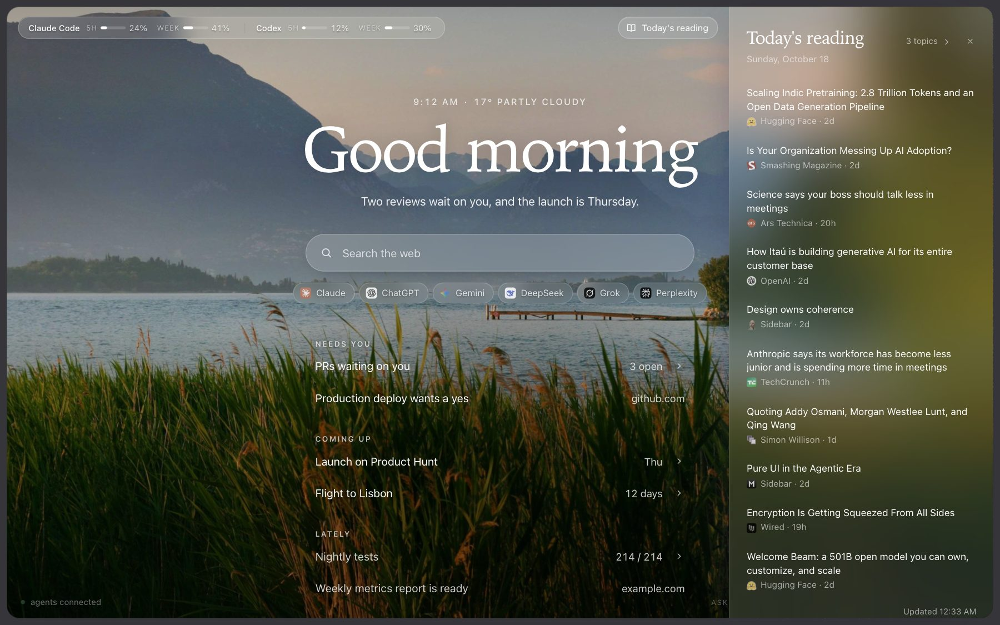
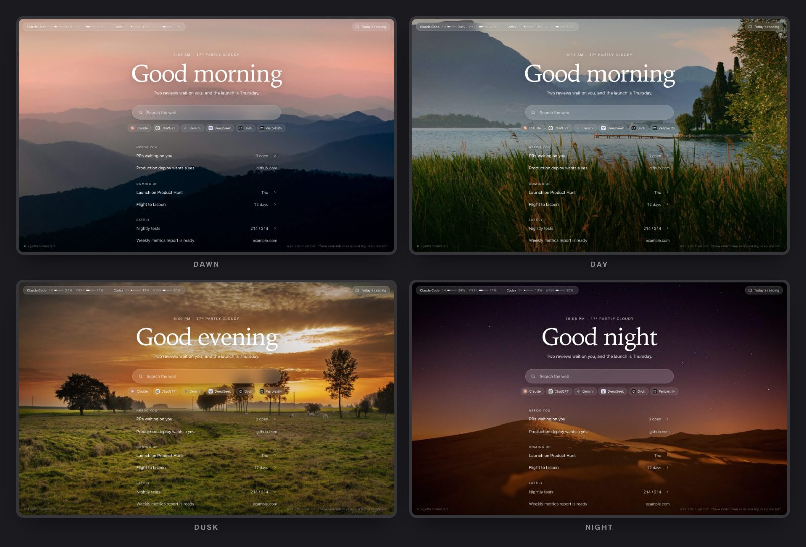

<h1 align="center">Stilltab</h1>

<p align="center"><b>A calm new tab your AI agents keep current.</b><br>
Works with Claude Code, Codex, Gemini CLI, OpenCode and any agent that can run a command.</p>

<p align="center"><a href="https://anup-a.github.io/stilltab/">Website</a> · <a href="#install">Install</a> · <a href="https://anup-a.github.io/stilltab/privacy.html">Privacy</a></p>



Every new tab shows one quiet page: what needs you, what's coming up, what just finished, over a photo that follows the time of day. Your agent decides what matters most and keeps it tidy through a small CLI, `tab`, on a schedule you choose.

- **Needs you, Coming up, Lately:** one line each with a short number ("3 open", "12 days"). Click for details. Tick or dismiss and your agent adapts next run.
- **A routine:** your agent runs headless every few hours and refreshes the page.
- **Plan usage** for Claude Code and Codex, **weather**, AI shortcuts, your most visited sites, and **Today's reading** in Chrome's side panel.
- **Private:** everything lives in `~/.stilltab` on your machine and is served from 127.0.0.1. No accounts, no analytics.

## Install

You need Node 20+ and Chrome (or any browser, as a plain page).

**1. Install the `tab` command**

```
npm i -g github:anup-a/stilltab
```

**2. Add the extension to Chrome**

The Chrome Web Store listing is on its way. Until then, load it from the package you just installed:

```
open "$(npm root -g)/stilltab/extension"     # macOS: shows the folder
```

Go to `chrome://extensions`, turn on **Developer mode**, click **Load unpacked** and pick that `extension` folder.

**3. Open a new tab and copy the prompt**



**4. Paste it into your agent**

It asks a few questions, all with defaults, then sets everything up: keeps the server running, applies your choices, creates the routine and does the first refresh.



**5. That's it.** Your agent keeps the tab current from now on. Ask it to change anything ("hide the weather", "refresh every hour").

<table>
<tr>
<td width="50%"><p align="center"><sub>Click a line for details</sub></p></td>
<td width="50%"><p align="center"><sub>Today's reading, from topics and feeds you pick</sub></p></td>
</tr>
</table>

## Looks

Dawn, day, dusk and night each have their own photo. Dawn and dusk pick a different one every day. Or switch to a blurred scene or a soft gradient sky with `tab theme scene|sky`.



## Set it up by hand

Click "I'll do it myself" on the setup popup, then:
```
tab autostart on                                   # or: tab serve &
tab weather "Dubai"                                # tab show usage|weather|ask|sites|reading|hint on|off
tab show sites on                                  # your most visited sites under the AI shortcuts (or a fixed list: tab sites '[…]')
tab news topics tech ai
tab theme photo                                    # sky | scene | photo
tab routine set --every 2h --hours 8-22 --agent claude --brief "Open PRs, CI on main, my next trip"
tab routine run                                    # once now; log in ~/.stilltab/routine.log
```
Change anything later by asking your agent ("hide the weather", "refresh every hour"), or with the same commands. `tab routine off` and `tab autostart off` remove the background jobs.

**Without the extension:** run the server and open http://127.0.0.1:7777. Same page; Today's reading opens as a drawer.

## How it works

- `bin/tab.mjs`: CLI agents call (`pin`, `set`, `brief`, `notice`, `layout`, `read`, `events`, …)
- `lib/server.mjs`: state file → live updates (SSE); serves sandboxed HTML widgets at `/w/:id`
- `extension/`: MV3: `newtab.html` (greeting, search, AI shortcuts, agents' lines) and `feed.html` (side panel, headlines only); one shared `app.js`/`app.css`; `background.js` toggles the panel. Paints from cache, animates only what changed; sky follows time of day
- `lib/news.mjs`: Today's reading: RSS/Atom presets per topic (tech, ai, science, design, business, world, sports) + custom feeds, refreshed once a day, interleaved so no source dominates
- `lib/usage.mjs`: the usage pill at the top left: how much of each Claude Code and Codex rate-limit window (5 hours, week) you've used. Read-only, from each tool's own login (Claude Code's keychain entry, `~/.codex`) or Codex's session logs; polled every 5 minutes, only while a new tab is open. Hover for reset times
- `lib/onboard.mjs`: `tab onboard` (the setup interview agents follow) and `tab routine prompt` (what each scheduled run follows)
- `lib/routine.mjs`: background jobs: `tab autostart` (server at login) and `tab routine` (your agent on a schedule, with quiet hours). launchd on macOS; prints a crontab line elsewhere
- `lib/weather.mjs`: weather beside the time (Open-Meteo, no key), every 30 minutes while a tab is open
- `skill/SKILL.md`: teaches agents the rules (calm, ≤6 widgets, use `--ttl`, read `events`)

Security: only the extension or the local page can read state (other origins get 403). Agent HTML runs in an opaque-origin sandbox and can't reach the page, cookies or tabs. Search always goes through the user's own search engine (`chrome.search`).

## More on looks

`tab theme sky` (default) is the soft drifting gradient. `tab theme scene` swaps it for a blurred landscape that follows the time of day (dawn, day, dusk, night), with light text and the agents' lines on one glass card. The scenes are 96px Unsplash thumbnails via picsum.photos (Unsplash license), ~2 KB each, blurred up in CSS. `tab theme photo` shows the photos sharp and full size (2400px, ~100 to 650 KB each, in `extension/photos/`; dawn and dusk each have several and show a different one every day, credits in `extension/photos/CREDITS.md`), with the agents' lines straight on the picture and the AI shortcuts hidden until you type.
